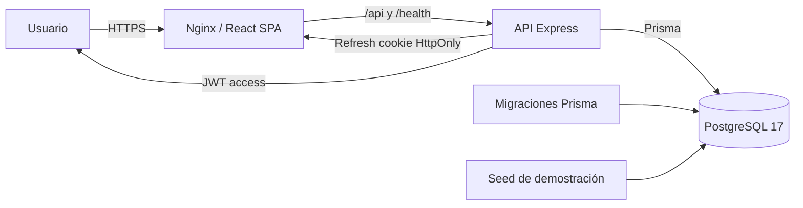

# IT Incident Hub

Plataforma full-stack para registrar, priorizar, asignar, resolver y auditar incidentes de TI. El proyecto combina un backend REST con reglas de negocio explícitas, una interfaz empresarial responsive y una capa DevOps reproducible con Docker, migraciones, seeds, pruebas E2E y CI/CD.

> Proyecto de portafolio construido con foco en seguridad, mantenibilidad, trazabilidad y operación real.

## Funcionalidades

- Autenticación con access token de corta duración y refresh token rotativo en cookie `HttpOnly`.
- Detección de reutilización de refresh tokens y revocación inmediata de la sesión.
- Roles `ADMIN`, `AGENT` y `REPORTER` con alcance de datos y acciones diferenciadas.
- Registro de incidentes con impacto, urgencia y prioridad calculada por matriz.
- Flujo de estados controlado por una máquina de estados y registro de actividad.
- Asignación de agentes, comentarios públicos, notas internas y línea de tiempo.
- SLA por prioridad, semáforo de vencimiento y métricas de cumplimiento.
- Dashboard con KPIs, distribuciones, tendencia de 14 días y actividad reciente.
- Búsqueda, filtros, ordenamiento y paginación sincronizados con la URL.
- Interfaz responsive con drawer móvil, modales accesibles, toasts y estados de carga/error.
- Health checks de liveness/readiness, logging estructurado y apagado graceful.
- Docker multi-stage, Nginx con proxy inverso y cabeceras de seguridad, Compose productivo y de desarrollo.
- CI con lint, typecheck, 256 pruebas unitarias/integración, 9 pruebas E2E sobre PostgreSQL real, build, auditoría, imágenes Docker y smoke test del stack.
- Publicación opcional de imágenes en GHCR y actualizaciones automatizadas con Dependabot.

## Stack

| Capa | Tecnología |
| --- | --- |
| Backend | Node.js 24, TypeScript, Express 4, Prisma 6, Zod 4 |
| Base de datos | PostgreSQL 17 |
| Frontend | React 19, Vite 8, TypeScript, Tailwind CSS 4, Recharts 3 |
| Estado remoto | TanStack Query 5, Axios |
| Autenticación | `jsonwebtoken`, `bcrypt`, cookies `HttpOnly` |
| Observabilidad | Pino, health checks, request IDs |
| Pruebas | Vitest 5, Supertest, Testing Library |
| DevOps | Docker, Docker Compose, Nginx, GitHub Actions, GHCR, Dependabot |

## Arquitectura



El backend separa rutas, controladores, servicios, dominio puro y acceso a datos. Las reglas críticas —prioridad, SLA, máquina de estados y métricas— viven en `backend/src/domain` y se prueban de forma aislada. El frontend consume una API tipada, mantiene el access token solo en memoria y renueva la sesión de forma transparente.

```text
.
├── backend/                 # API Express + Prisma
│   ├── src/
│   │   ├── config/          # Entorno, logger, Prisma
│   │   ├── controllers/     # Adaptadores HTTP
│   │   ├── domain/          # Reglas de negocio puras
│   │   ├── middlewares/     # Auth, validación, errores, rate limit
│   │   ├── routes/          # Definición de endpoints
│   │   ├── schemas/         # Validación Zod
│   │   ├── services/        # Casos de uso y transacciones
│   │   └── utils/           # JWT, cookies, serialización, paginación
│   └── tests/               # 86 pruebas unitarias y de integración
├── frontend/                # SPA React + Vite
│   └── src/
│       ├── components/      # Layout, dashboard, incidentes y UI
│       ├── context/         # Autenticación y toasts
│       ├── hooks/           # Hooks reutilizables
│       ├── lib/             # Utilidades y lógica testeable
│       ├── pages/           # Dashboard, login, listado, detalle, alta
│       └── services/        # Cliente HTTP y servicios de API
├── database/
│   ├── prisma/              # Esquema y migraciones
│   ├── seeds/               # Datos de demostración
│   └── docker/              # Inicialización de la base de pruebas
├── tests/e2e/               # 9 pruebas E2E contra PostgreSQL real
├── scripts/                 # Preparación E2E y entorno Docker
├── docs/                    # Arquitectura, API y DevOps
├── docker-compose.yml       # Stack completo
└── docker-compose.dev.yml   # PostgreSQL para desarrollo local
```

## Inicio rápido con Docker

Requisitos: Docker Desktop o Docker Engine con Compose v2.

```bash
npm run docker:env   # genera .env.docker con secretos aleatorios
npm run docker:up    # construye y levanta db, migraciones, API y web
npm run docker:seed  # carga usuarios e incidentes de demostración
```

Abre [http://localhost:8080](http://localhost:8080).

| Servicio | Acceso |
| --- | --- |
| Aplicación web | `http://localhost:8080` |
| API (solo dentro de la red Docker) | `http://api:4000` |
| PostgreSQL (solo dentro de la red Docker) | `db:5432` |

Comandos útiles:

```bash
npm run docker:logs
npm run docker:down
npm run docker:config
```

El stack publica la web únicamente en `127.0.0.1`. Para exponerlo en otro host, ajusta `WEB_PORT` y `CORS_ORIGINS` en `.env.docker`. En producción real debe existir terminación TLS delante de Nginx y `COOKIE_SECURE=true`.

## Inicio rápido local

Requisitos: Node.js 24+, npm 11+ y PostgreSQL 17 (local o Docker).

```bash
npm install
cp backend/.env.example backend/.env
```

Edita `backend/.env` con tu cadena de conexión y secretos. Para levantar solo PostgreSQL en Docker:

```bash
npm run db:dev:up
```

Esto expone PostgreSQL en `127.0.0.1:5433` y crea las bases `incidenthub` e `incidenthub_test`. El archivo `backend/.env.example` ya apunta a ese puerto.

Luego:

```bash
npm run db:setup   # genera cliente, aplica migraciones y siembra datos
npm run dev        # API en :4000 y web en :5173
```

Abre [http://localhost:5173](http://localhost:5173).

### Variables de entorno relevantes

| Variable | Descripción |
| --- | --- |
| `DATABASE_URL` | Cadena PostgreSQL de la aplicación |
| `TEST_DATABASE_URL` | Base aislada para E2E; debe terminar en `_test` |
| `JWT_ACCESS_SECRET` / `JWT_REFRESH_SECRET` | Secretos distintos de al menos 32 caracteres |
| `JWT_ACCESS_TTL_SECONDS` | Vida del access token (por defecto 900) |
| `JWT_REFRESH_TTL_DAYS` | Vida del refresh token (por defecto 7) |
| `BCRYPT_ROUNDS` | Coste de bcrypt (10–15) |
| `CORS_ORIGINS` | Orígenes permitidos, separados por coma |
| `COOKIE_SECURE` | Obligatorio `true` en producción |
| `TRUST_PROXY` | Número de proxies de confianza delante de Express |

Genera secretos con:

```bash
node -e "console.log(require('crypto').randomBytes(48).toString('base64url'))"
```

## Credenciales de demostración

| Rol | Correo | Contraseña |
| --- | --- | --- |
| Administrador | `admin@incidenthub.dev` | `Admin123!` |
| Agente | `diego.agente@incidenthub.dev` | `Agent123!` |
| Usuario reportante | `andres.usuario@incidenthub.dev` | `User123!` |

Las cuentas solo existen después de ejecutar el seed. No reutilices estas credenciales en un entorno real.

## Scripts

| Comando | Descripción |
| --- | --- |
| `npm run dev` | API y frontend en modo desarrollo |
| `npm run build` | Compila backend y frontend |
| `npm run typecheck` | Verificación TypeScript estricta |
| `npm run lint` | ESLint en ambos workspaces |
| `npm test` | 86 pruebas backend + 170 frontend |
| `npm run audit:prod` | Auditoría de dependencias de producción |
| `npm run test:e2e` | Prepara la base `_test` y ejecuta 9 pruebas E2E |
| `npm run db:generate` | Genera el cliente Prisma |
| `npm run db:migrate` | Crea/aplica migraciones en desarrollo |
| `npm run db:deploy` | Aplica migraciones existentes |
| `npm run db:seed` | Carga datos de demostración |
| `npm run db:reset` | Reinicia la base y vuelve a sembrar |
| `npm run db:dev:up` / `db:dev:down` | PostgreSQL de desarrollo en Docker |
| `npm run docker:env` | Genera `.env.docker` con secretos |
| `npm run docker:up` / `docker:down` | Stack completo en Docker |
| `npm run docker:seed` | Siembra el stack Docker |
| `npm run docker:logs` | Logs del stack |
| `npm run docker:config` | Valida la configuración Compose |

## Pruebas

- **Backend (86):** dominio, JWT, cookies, validación, serialización, servicios y rutas con Supertest.
- **Frontend (170):** utilidades, formularios, filtros, permisos, paginación, componentes y flujo de login.
- **E2E (9):** autenticación y rotación de refresh, RBAC, ciclo completo de incidentes, comentarios internos, validación, filtros y dashboard, todo contra PostgreSQL real.

La suite E2E usa `TEST_DATABASE_URL`, aplica migraciones, trunca tablas con `RESTART IDENTITY` y ejecuta el seed. El script de preparación rechaza bases cuyo nombre no termine en `_test` y no puede ejecutarse con `NODE_ENV=production`.

```bash
npm run test:e2e
```

## Seguridad

- Contraseñas con bcrypt y comparación de tiempo constante para tokens.
- Access token en memoria del navegador; refresh token en cookie `HttpOnly`, `SameSite=Lax` y `Secure` en producción.
- Rotación de refresh tokens con hash SHA-256 en base de datos y detección de reutilización.
- `helmet`, CORS restringido, límites de tasa globales y específicos para login/refresh.
- Validación estricta con Zod, objetos `.strict()` y límites de tamaño.
- Consultas exclusivamente vía Prisma; sin SQL concatenado ni ORM alternativo.
- Errores centralizados con `requestId`; nunca se filtran stack traces, SQL ni detalles internos.
- Logging con redacción de cookies, tokens y contraseñas.
- Contenedores multi-stage; API como usuario `node`, Nginx sin privilegios, filesystems de solo lectura y capacidades eliminadas en API/web; `no-new-privileges`; base de datos y API no expuestas al host.
- Nginx con CSP, `X-Content-Type-Options`, `X-Frame-Options`, `Referrer-Policy` y `Permissions-Policy`.
- `npm run audit:prod` sin vulnerabilidades de producción.

## DevOps

- Migraciones automáticas como servicio previo al arranque de la API.
- Seed separado y ejecutable bajo demanda.
- Health checks en PostgreSQL, API y Nginx.
- Apagado graceful con cierre de conexiones HTTP y Prisma.
- Imágenes de producción con solo dependencias necesarias y cliente Prisma generado.
- CI en GitHub Actions: calidad, E2E con PostgreSQL, build Docker, smoke test del stack, auditoría y Dependency Review.
- Publicación opcional a GHCR en la rama por defecto.
- Dependabot para npm, GitHub Actions, Docker y Compose.

Consulta [docs/devops.md](docs/devops.md) para el runbook completo.

## Documentación

- [Arquitectura y decisiones](docs/arquitectura.md)
- [Referencia de API](docs/api.md)
- [Guía DevOps y operación](docs/devops.md)

## Limitaciones conocidas

- El rate limiting es en memoria: para escalar horizontalmente se debe usar un store compartido como Redis.
- El stack Docker local no incluye terminación TLS; en producción se debe colocar detrás de un proxy/load balancer con HTTPS.
- No hay notificaciones por correo ni trabajos en segundo plano; el alcance es gestión y trazabilidad de incidentes.
- Prisma 6 muestra un aviso de deprecación por `package.json#prisma`; conviene migrar a `prisma.config.ts` antes de Prisma 7.

## Estado del proyecto

- Typecheck, lint y build: correctos.
- 256 pruebas unitarias/integración y 9 E2E: correctas.
- `npm audit` y `npm run audit:prod`: sin vulnerabilidades.
- Stack Docker verificado localmente: health checks, SPA, login, rotación de refresh token, cabeceras de seguridad y contenedores sin privilegios con rootfs de solo lectura.
- CI listo para ejecutarse en GitHub Actions.
