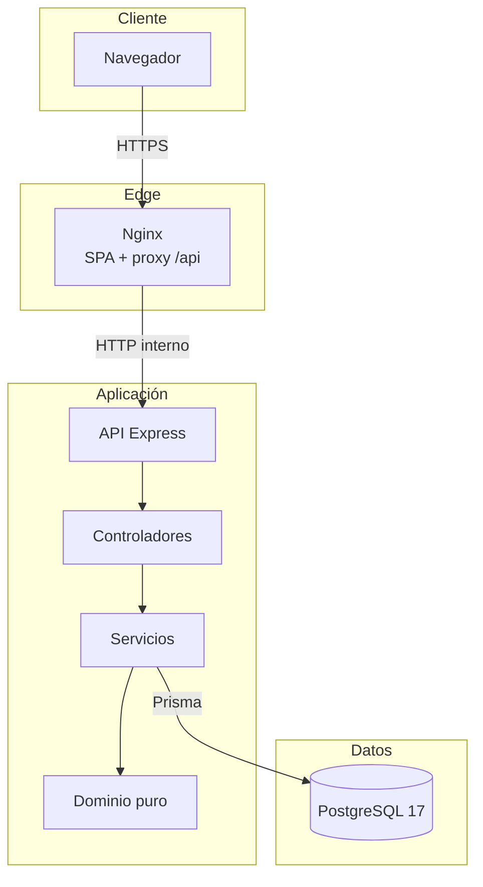
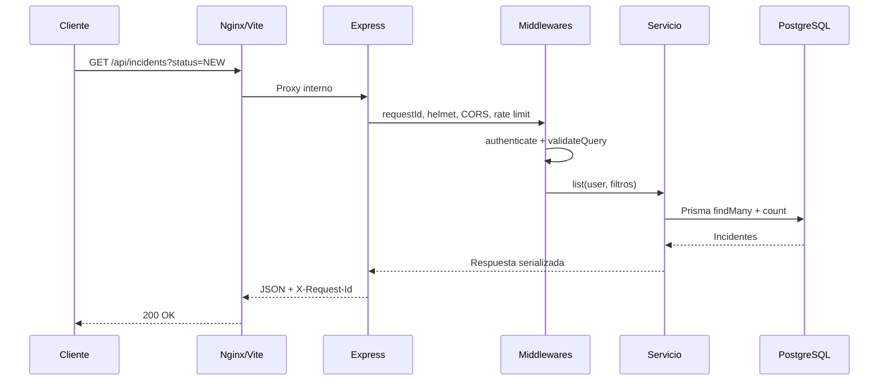
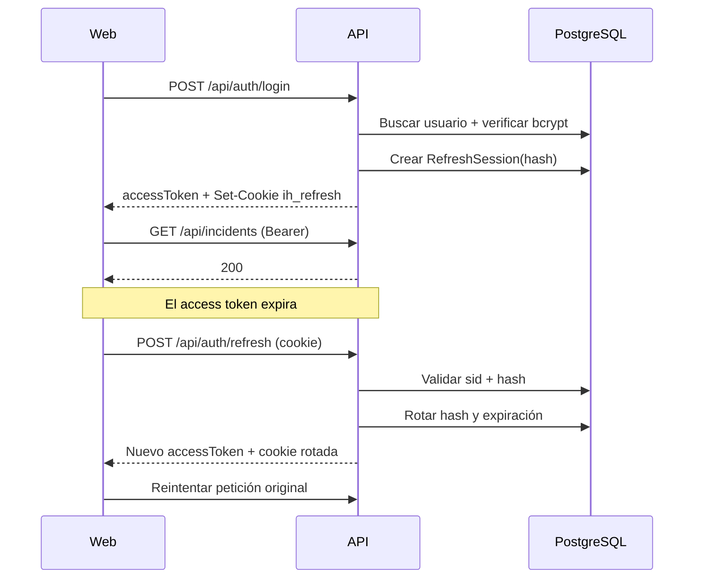
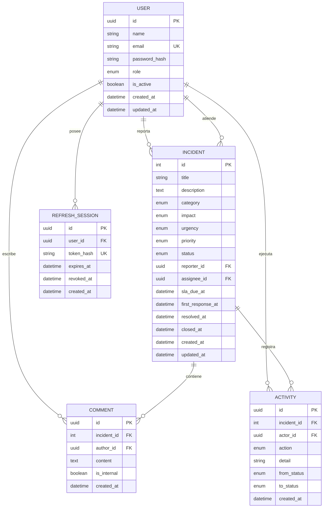

# Arquitectura y decisiones

## 1. Visión general

IT Incident Hub es un monorepo con tres artefactos desplegables:

1. **API REST** en Node.js/TypeScript con Express y Prisma.
2. **SPA** en React/Vite servida por Nginx.
3. **PostgreSQL 17** con migraciones versionadas y datos de demostración.

La API es la única capa que accede a la base de datos. El frontend consume `/api` a través de Nginx en Docker o del proxy de Vite en desarrollo. El navegador nunca recibe credenciales de base de datos ni ejecuta reglas de negocio críticas.

## 2. Principios de diseño

- **Reglas de negocio puras y testeables:** prioridad, SLA, estados y métricas no dependen de Express ni Prisma.
- **Una sola fuente de verdad:** la prioridad se calcula en el dominio; la API no acepta prioridad del cliente.
- **Validación en el borde:** Zod valida body, params y query antes de llegar al servicio.
- **Autorización en dos niveles:** middleware por rol y alcance de datos dentro de los servicios.
- **Errores seguros:** el cliente recibe códigos estables y `requestId`; los detalles internos solo van al log.
- **TypeScript estricto:** sin `any`, sin supresiones generalizadas y con tipos derivados de Zod/Prisma.
- **Operación reproducible:** migraciones, seeds, health checks y configuración por entorno.

## 3. Capas del backend

| Capa | Ubicación | Responsabilidad |
| --- | --- | --- |
| Configuración | `backend/src/config` | Validación de entorno, logger Pino, cliente Prisma |
| Rutas | `backend/src/routes` | Composición de middleware y endpoints |
| Controladores | `backend/src/controllers` | Traducir HTTP ↔ casos de uso |
| Validación | `backend/src/schemas` | Esquemas Zod estrictos |
| Middlewares | `backend/src/middlewares` | Auth, roles, rate limit, errores, request ID |
| Servicios | `backend/src/services` | Casos de uso, transacciones, alcance por rol |
| Dominio | `backend/src/domain` | Prioridad, SLA, máquina de estados, métricas |
| Persistencia | `database/prisma` | Esquema, migraciones e índices |
| Utilidades | `backend/src/utils` | JWT, cookies, serialización, paginación, errores |

### Flujo de una petición

## 4. Autenticación y sesión

- El **access token** es un JWT HS256 de 15 minutos con `jti`, `sub`, `email`, `name`, `role`, `type=access`, `iss` y `aud`.
- El **refresh token** es un JWT de 7 días con `sid` (sesión) y `jti`, almacenado en cookie `HttpOnly`, `SameSite=Lax`, `Path=/api/auth` y `Secure` en producción.
- En base de datos solo se guarda el hash SHA-256 del refresh token, nunca el valor original.
- Cada refresco rota el token y actualiza el hash. Si llega un token válido cuyo hash no coincide, se asume reutilización y se revoca la sesión completa.
- El frontend mantiene el access token **solo en memoria**. Al recargar, intenta refrescar usando la cookie; si falla, redirige a login.
- Axios implementa un refresco *single-flight*: varias peticiones concurrentes con 401 comparten la misma promesa de refresh y reintentan una sola vez.

## 5. Modelo de datos

Índices relevantes: `(status, created_at)`, `(priority, status)`, `(assignee_id, status)`, `(reporter_id, created_at)`, `(sla_due_at, status)`, `(incident_id, created_at)` y `(user_id, revoked_at)`.

## 6. Reglas de negocio

### Matriz de prioridad

La prioridad se deriva de impacto × urgencia. El cliente no puede enviarla.

| Impacto \ Urgencia | Baja | Media | Alta |
| --- | --- | --- | --- |
| Crítico | Alta | Crítica | Crítica |
| Alto | Media | Alta | Alta |
| Medio | Baja | Media | Alta |
| Bajo | Baja | Baja | Media |

### SLA de resolución

| Prioridad | Horas objetivo | Semáforo |
| --- | --- | --- |
| Crítica | 4 | `ON_TRACK`, `AT_RISK` (≤4 h), `BREACHED`, `MET`, `MISSED` |
| Alta | 8 | Igual |
| Media | 24 | Igual |
| Baja | 72 | Igual |

El vencimiento se calcula desde `createdAt`. Al resolver o cerrar, el estado SLA pasa a `MET` o `MISSED` comparando `resolvedAt` con `slaDueAt`.

### Máquina de estados

| Estado actual | Transiciones permitidas |
| --- | --- |
| `NEW` | `ASSIGNED`, `IN_PROGRESS`, `CANCELLED` |
| `ASSIGNED` | `IN_PROGRESS`, `ON_HOLD`, `CANCELLED` |
| `IN_PROGRESS` | `ON_HOLD`, `RESOLVED`, `CANCELLED` |
| `ON_HOLD` | `IN_PROGRESS`, `RESOLVED`, `CANCELLED` |
| `RESOLVED` | `CLOSED`, `IN_PROGRESS` |
| `CLOSED` | `IN_PROGRESS` |
| `CANCELLED` | Ninguna |

Los estados que requieren responsable (`ASSIGNED`, `IN_PROGRESS`, `ON_HOLD`, `RESOLVED`, `CLOSED`) asignan automáticamente al usuario que ejecuta la transición si aún no hay responsable. La API expone `allowedTransitions` en el detalle para que la UI no invente transiciones.

### Permisos

| Acción | ADMIN | AGENT | REPORTER |
| --- | --- | --- | --- |
| Ver dashboard global | Sí | Sí | No (solo propios) |
| Listar/ver incidentes | Todos | Todos | Solo reportados por él |
| Crear incidente | Sí | Sí | Sí |
| Editar datos | Sí | Sí | Solo `NEW` y sin cambiar impacto/urgencia |
| Asignar | Cualquier agente/admin | Solo a sí mismo | No |
| Cambiar estado | Sí | Sí | No |
| Comentar | Sí | Sí | Sí, solo en sus incidentes |
| Nota interna | Sí | Sí | No |
| Listar agentes | Sí | Sí | Sí (para formularios) |

### Dashboard

- `ADMIN` y `AGENT`: alcance global.
- `REPORTER`: alcance propio (`reporterId = user.id`).
- KPIs: total, abiertos, sin asignar, en progreso, SLA en riesgo, SLA vencidos, resueltos últimos 7 días, promedio de resolución y cumplimiento SLA.
- Distribuciones por estado, prioridad y categoría; tendencia diaria de 14 días y últimos incidentes.

## 7. Frontend

- **Rutas:** `/login`, `/` (dashboard), `/incidents`, `/incidents/new`, `/incidents/:id`, `*`.
- **Protección:** `ProtectedRoute` espera la hidratación de sesión antes de decidir; evita parpadeos de login.
- **Estado del servidor:** TanStack Query con claves centralizadas y políticas de reintento/caché.
- **Estado de sesión:** contexto de autenticación + token store en memoria.
- **Filtros:** sincronizados con `useSearchParams`; la búsqueda actualiza la URL de inmediato y la consulta se debouncea 400 ms.
- **Formularios:** React Hook Form + validación cliente, errores de servidor fusionados por campo.
- **UI:** Tailwind 4, sidebar navy, acento índigo, tablas responsive, drawer móvil, modales con foco y cierre por teclado.
- **Accesibilidad:** labels, `aria-*`, roles, foco visible, contraste y mensajes de error anunciables.
- **Rendimiento:** code splitting de vendor, charts y datos; gráficos cargados en chunk separado.

## 8. Estrategia de pruebas

| Nivel | Herramienta | Alcance |
| --- | --- | --- |
| Dominio | Vitest | Matriz de prioridad, SLA, estados, métricas, paginación |
| Backend | Vitest + Supertest | Rutas, validación, auth, errores, servicios con Prisma mockeado |
| Frontend | Vitest + Testing Library | Utilidades, formularios, filtros, permisos, componentes |
| E2E | Vitest + Supertest + PostgreSQL real | Flujo completo, RBAC, refresh rotation, dashboard, filtros |

La suite E2E no usa mocks de base de datos. El script `scripts/e2e-prepare.mjs` aplica `prisma migrate deploy`, trunca tablas con `RESTART IDENTITY CASCADE` y ejecuta el seed. Se niega a operar sobre una base cuyo nombre no termine en `_test`.

## 9. Decisiones (ADR resumidas)

| Decisión | Motivo | Consecuencia |
| --- | --- | --- |
| Monorepo con npm workspaces | Un solo lockfile, scripts coordinados y tipos compartidos por proximidad | El build Docker debe copiar los `package.json` de ambos workspaces |
| Prisma como único ORM | Consultas parametrizadas, migraciones y tipos generados | Dependencia del CLI de Prisma en desarrollo |
| Access token en memoria | Reduce exposición ante XSS persistente | Requiere refresh al recargar |
| Refresh rotativo con hash | Limita robo/reutilización y permite revocación | Una fila por sesión y lógica de detección |
| Dominio puro separado | Reglas testeables sin HTTP/DB | Duplicación mínima de tipos en serialización |
| Zod en el borde | Errores consistentes y tipos inferidos | Hay que mantener esquemas y tipos alineados |
| Docker multi-stage | Imágenes pequeñas y sin toolchain | Build más largo en frío |
| Nginx como edge | SPA, proxy y cabeceras en un solo punto | La API no se expone directamente |
| Rate limit en memoria | Simplicidad para una instancia | No escala horizontalmente sin Redis |

## 10. Evolución prevista

- Migrar a Prisma 7 y a `prisma.config.ts` cuando se valide la compatibilidad; el campo `package.json#prisma` está deprecado.
- Store distribuido para rate limiting y sesiones si se escala a varias réplicas.
- Notificaciones por correo/Teams y jobs de recordatorio de SLA.
- Exportación de auditoría y métricas a Prometheus/OpenTelemetry.
- Pruebas de carga y caos sobre el flujo de incidentes.
