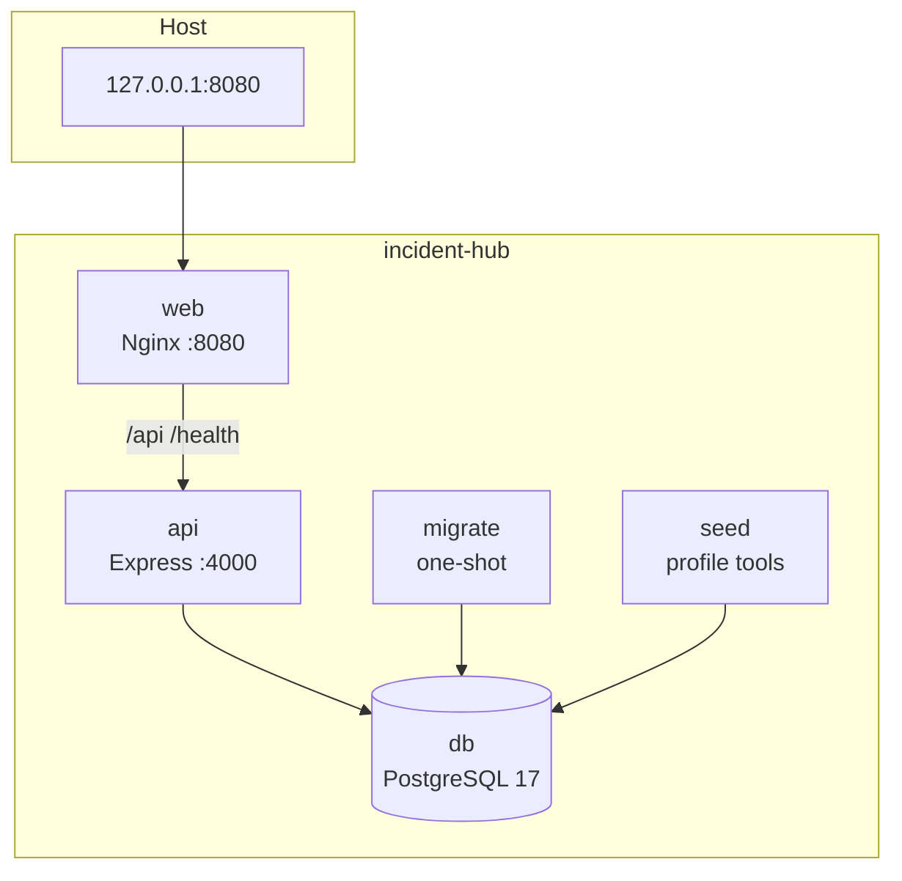

# Guía DevOps y operación

## 1. Entornos

| Entorno | Base de datos | API | Web | Uso |
| --- | --- | --- | --- | --- |
| Desarrollo local | PostgreSQL en `localhost:5433` o nativo | `tsx watch` en `:4000` | Vite en `:5173` | Día a día |
| Pruebas unitarias | Mocks / sin conexión | Vitest | Vitest + jsdom | CI y local |
| E2E | PostgreSQL aislado `*_test` | App real con Supertest | — | CI y local |
| Docker local | PostgreSQL en red interna | Contenedor `:4000` | Nginx en `127.0.0.1:8080` | Demo y validación |
| Producción | PostgreSQL gestionado | Réplicas detrás de LB | Nginx/CDN | Operación real |

## 2. Configuración local

### 2.1 Solo base de datos en Docker

```bash
npm run db:dev:up
```

Servicio `incident-hub-dev-db`:

- Imagen `postgres:17-alpine`.
- Puerto `127.0.0.1:5433`.
- Base principal `incidenthub`.
- Base E2E `incidenthub_test` creada por `database/docker/init-test-db.sql`.
- Volumen `postgres-dev-data`.
- Health check con `pg_isready`.

Si el volumen ya existía sin la base de pruebas, recrea el volumen:

```bash
npm run db:dev:reset
npm run db:dev:up
```

### 2.2 PostgreSQL nativo

Crea las bases y el usuario:

```sql
CREATE USER incidenthub WITH PASSWORD 'incidenthub';
CREATE DATABASE incidenthub OWNER incidenthub;
CREATE DATABASE incidenthub_test OWNER incidenthub;
```

Ajusta `DATABASE_URL` y `TEST_DATABASE_URL` en `backend/.env` al puerto `5432`.

### 2.3 Variables de entorno

`backend/.env` es local y está ignorado por Git. `backend/.env.example` documenta todas las variables. En producción se deben inyectar por el orquestador o un gestor de secretos, nunca hornear en la imagen.

| Variable | Obligatoria | Notas |
| --- | --- | --- |
| `DATABASE_URL` | Sí | PostgreSQL |
| `JWT_ACCESS_SECRET` | Sí | ≥32 caracteres, distinto del refresh |
| `JWT_REFRESH_SECRET` | Sí | ≥32 caracteres |
| `COOKIE_SECURE` | Sí | `true` obligatorio en producción |
| `CORS_ORIGINS` | Sí | Lista separada por coma |
| `PORT` | No | `4000` |
| `TRUST_PROXY` | No | `1` detrás de Nginx/LB |
| `BCRYPT_ROUNDS` | No | `12` por defecto, rango 10–15 |
| `LOG_LEVEL` | No | `info` |

La API falla al arrancar si la configuración es inválida. Esto es intencional: es mejor fallar rápido que operar con secretos débiles o CORS abierto.

## 3. Imágenes Docker

### 3.1 Backend (`backend/Dockerfile`)

| Etapa | Contenido | Uso |
| --- | --- | --- |
| `base` | Node 24 slim + OpenSSL | Base común |
| `deps` | `npm ci` del monorepo | Dependencias |
| `build` | Cliente Prisma + `tsc` | Artefactos |
| `migrator` | Prisma CLI + esquema | `prisma migrate deploy` |
| `seeder` | `tsx` + seed | Datos de demostración |
| `production` | Solo deps de producción, `.prisma` generado y `dist` | Runtime API |

Características:

- Usuario `node` no root.
- `npm ci --omit=dev --omit=optional --workspace @incident-hub/backend` para evitar Prisma CLI y dependencias de frontend.
- Cliente Prisma generado en la etapa de build y copiado a producción.
- Health check nativo con `fetch` a `/health/ready`.
- `PRISMA_SKIP_POSTINSTALL_GENERATE=true` evita generaciones accidentales durante la instalación de producción.

### 3.2 Frontend (`frontend/Dockerfile`)

| Etapa | Contenido | Uso |
| --- | --- | --- |
| `build` | Node 24 + `npm ci` + Vite | Compilar SPA |
| `production` | `nginxinc/nginx-unprivileged:1.29-alpine` + `dist` | Servir SPA y proxy |

Nginx:

- Se ejecuta como usuario `nginx` (UID 101) y escucha en `8080`; no requiere capabilities para abrir el puerto.
- `try_files` con fallback a `index.html` para rutas del router.
- Proxy de `/api/` y `/health` hacia `api:4000`.
- Cabeceras CSP, `X-Content-Type-Options`, `X-Frame-Options`, `Referrer-Policy` y `Permissions-Policy`.
- Gzip para texto, JSON, JS, CSS y SVG.
- Cache inmutable para `/assets/` y `no-cache` para el HTML.
- `/healthz` para el health check del contenedor.

## 4. Stack completo

```bash
npm run docker:env
npm run docker:up
npm run docker:seed
```



Orden de arranque:

1. `db` inicia y supera el health check.
2. `migrate` aplica migraciones y termina con código 0.
3. `api` arranca solo si `db` está sana y `migrate` terminó correctamente.
4. `web` arranca cuando `api` está sana.
5. `seed` es opcional y se ejecuta con el perfil `tools`.

Decisiones de seguridad:

- PostgreSQL y API no publican puertos al host.
- La web se publica solo en `127.0.0.1`.
- API y web ejecutan con filesystem de solo lectura, `/tmp` en `tmpfs`, `cap_drop: ALL` y `no-new-privileges`.
- Nginx corre sin privilegios como usuario `nginx` en el puerto `8080`.
- Red interna dedicada.
- Secretos generados aleatoriamente por `scripts/docker-env.mjs` y almacenados en `.env.docker` con permisos restrictivos cuando el sistema lo permite.

### 4.1 Operación diaria

```bash
npm run docker:logs          # seguir logs
npm run docker:down          # detener sin borrar datos
npm run docker:up            # recrear/actualizar
npm run docker:seed          # crear datos demo si la base está vacía
```

El seed usa `upsert` para usuarios. Si ya existen incidentes, no los duplica: informa cuántos hay y sugiere `npm run db:reset`. No ejecutarlo sobre una base con datos reales.

### 4.2 Reset completo del stack

```bash
npm run docker:down
docker compose --env-file .env.docker down -v
npm run docker:up
npm run docker:seed
```

Esto elimina el volumen `postgres-data` y todos los datos.

## 5. Migraciones y seeds

### Desarrollo

```bash
npm run db:migrate   # prisma migrate dev
npm run db:seed
```

### Producción

```bash
npm run db:deploy    # prisma migrate deploy
```

El servicio `migrate` ejecuta exactamente `prisma migrate deploy` antes de la API. Las migraciones son **forward-only**: no se editan una vez aplicadas en un entorno compartido. Para corregir un error se crea una migración nueva.

### E2E

```bash
npm run test:e2e
```

El `pretest:e2e` ejecuta `scripts/e2e-prepare.mjs`:

1. Lee `TEST_DATABASE_URL` de `backend/.env` o del entorno.
2. Exige que el nombre de la base termine en `_test`.
3. Rechaza `NODE_ENV=production`.
4. Aplica `prisma migrate deploy`.
5. Trunca `activities`, `comments`, `refresh_sessions`, `incidents` y `users` con `RESTART IDENTITY CASCADE`.
6. Ejecuta el seed.

Nunca apuntes `TEST_DATABASE_URL` a una base compartida o productiva.

## 6. Integración continua

Archivo: `.github/workflows/ci.yml`.

| Job | Qué valida |
| --- | --- |
| `quality` | `npm ci`, Prisma generate, typecheck, lint, 256 pruebas, build y `npm run audit:prod` |
| `e2e` | PostgreSQL 17 como service, migraciones, seed y 9 pruebas E2E |
| `docker` | Build de ambas imágenes y `docker compose config` |
| `docker-smoke` | Levanta el stack, siembra, verifica health, SPA, login y cookie `HttpOnly` |
| `dependency-review` | Revisión de vulnerabilidades en pull requests |
| `publish` | Publica imágenes en GHCR solo en la rama por defecto |

Concurrencia: se cancela la ejecución anterior de la misma rama/PR.

### 6.1 Publicación en GHCR

Las imágenes se publican como:

```text
ghcr.io/<owner>/<repo>/api:latest
ghcr.io/<owner>/<repo>/api:sha-<commit>
ghcr.io/<owner>/<repo>/web:latest
ghcr.io/<owner>/<repo>/web:sha-<commit>
```

Requiere que el repositorio permita `GITHUB_TOKEN` con `packages: write`. No se necesitan secretos adicionales. Las imágenes incluyen SBOM y provenance.

Para usar una imagen publicada:

```bash
docker pull ghcr.io/<owner>/<repo>/api:latest
docker pull ghcr.io/<owner>/<repo>/web:latest
```

### 6.2 Dependabot

`.github/dependabot.yml` agrupa actualizaciones npm de producción, desarrollo y mayores; también actualiza GitHub Actions, Dockerfiles y Compose. Revisar especialmente los saltos mayores de Prisma, Express y React.

## 7. Runbook de producción

### 7.1 Antes de desplegar

1. Backup de base de datos.
2. Revisar migraciones pendientes: `npx prisma migrate status --schema database/prisma/schema.prisma`.
3. Verificar secretos y `COOKIE_SECURE=true`.
4. Confirmar que `CORS_ORIGINS` coincide con el dominio real.
5. Ejecutar CI en verde.
6. Desplegar primero la migración y luego la API (o usar el servicio `migrate`).

### 7.2 Despliegue

```bash
docker compose --env-file .env.docker pull
docker compose --env-file .env.docker up -d
```

Con imágenes publicadas, sustituir `build` por `image` en el Compose de producción o usar el orquestador correspondiente.

### 7.3 Verificación posterior

```bash
curl -fsS https://app.example.com/health/ready
curl -fsS https://app.example.com/healthz
```

Comprobar login, refresh, listado de incidentes y dashboard. Revisar logs por errores 5xx y latencia.

### 7.4 Rollback

- **Aplicación:** volver a la imagen/tag anterior (`sha-...`) y recrear el servicio.
- **Base de datos:** las migraciones no se revierten automáticamente. Si una migración es incompatible, restaurar el backup y desplegar la versión anterior.
- **Secretos:** rotar access/refresh invalida todas las sesiones; comunicar a los usuarios.

### 7.5 Rotación de secretos

1. Generar nuevos secretos.
2. Actualizar `.env.docker` o el gestor de secretos.
3. Recrear la API.
4. Todos los refresh tokens existentes dejan de validar; los usuarios deben iniciar sesión de nuevo.

### 7.6 Backup y restauración

Backup lógico:

```bash
docker compose --env-file .env.docker exec -T db \
  pg_dump -U incidenthub -d incidenthub -Fc > backup-$(date +%F).dump
```

Restauración:

```bash
docker compose --env-file .env.docker exec -T db \
  pg_restore -U incidenthub -d incidenthub --clean --if-exists < backup-2026-10-24.dump
```

Programar backups diarios, cifrado en reposo, retención y pruebas periódicas de restauración.

### 7.7 Logs y diagnóstico

- La API emite JSON estructurado con Pino.
- Cada petición tiene `X-Request-Id`; el mismo ID aparece en errores y logs.
- Los health checks se excluyen del log de acceso.
- No se registran cookies, tokens ni contraseñas.

```bash
docker compose --env-file .env.docker logs -f api
docker compose --env-file .env.docker logs -f web
docker compose --env-file .env.docker ps
```

## 8. Solución de problemas

| Síntoma | Causa probable | Acción |
| --- | --- | --- |
| `/health/ready` devuelve 503 | DB no accesible o migraciones no aplicadas | Revisar `db`, `DATABASE_URL` y logs de `migrate` |
| Login responde 200 pero no persiste sesión | Cookie `Secure` sobre HTTP o CORS incorrecto | Usar HTTPS o `localhost`; revisar `COOKIE_SECURE` y `CORS_ORIGINS` |
| `npm run test:e2e` rechaza la base | Nombre sin sufijo `_test` | Usar `incidenthub_test` |
| `npm ci` falla por binarios opcionales | Lockfile generado sin opcionales de otras plataformas | Regenerar el lock desde cero con `npm install --package-lock-only --include=optional`; verificar que existan las entradas `@tailwindcss/oxide-linux-x64-gnu` y `@tailwindcss/oxide-win32-x64-msvc` antes de hacer commit |
| Prisma no encuentra el motor | `node_modules` copiado entre plataformas | Reconstruir la imagen; no copiar `node_modules` del host |
| Puerto 8080 ocupado | Otro servicio local | Cambiar `WEB_PORT` y actualizar `CORS_ORIGINS` en `.env.docker` |
| Docker daemon no disponible | Docker Desktop detenido | Iniciar Docker Desktop/Engine |
| 429 en pruebas manuales | Rate limit activo | Esperar la ventana o usar `NODE_ENV=test` |
| Seed duplica datos | Se ejecutó sobre una base con datos | Usar base limpia o `db:reset` en desarrollo |

## 9. Checklist de seguridad para producción

- [ ] TLS terminado antes de Nginx; redirección HTTP → HTTPS.
- [ ] `COOKIE_SECURE=true` y `TRUST_PROXY` correcto.
- [ ] Secretos JWT distintos, aleatorios y almacenados fuera de la imagen.
- [ ] Contraseña de PostgreSQL robusta y acceso restringido por red.
- [ ] `CORS_ORIGINS` con dominios exactos, sin comodines.
- [ ] Backups cifrados y restauración probada.
- [ ] Logs centralizados con retención y alertas de 5xx/SLA.
- [ ] `npm run audit:prod` sin hallazgos altos/críticos.
- [ ] Imágenes fijadas por digest o tag inmutable.
- [ ] Rate limiting distribuido si hay más de una réplica.
- [ ] Revisión de dependencias y actualizaciones periódicas.
- [ ] Monitoreo de `/health/ready` y del certificado TLS.

## 10. Limitaciones y siguientes pasos

- Rate limiting en memoria: sustituir por Redis para múltiples réplicas.
- Sin TLS incluido en Compose: usar Traefik, Caddy, Cloudflare o un LB gestionado.
- Sin observabilidad avanzada: añadir OpenTelemetry, Prometheus/Grafana y alertas.
- Sin jobs en segundo plano: evaluar BullMQ/Redis para recordatorios de SLA y notificaciones.
- Migrar la configuración de Prisma a `prisma.config.ts` antes de Prisma 7; el campo `package.json#prisma` está deprecado.
- Sin pruebas de carga: añadir k6 o Artillery para validar límites y latencia.
